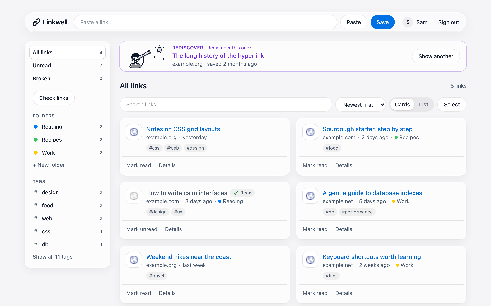

# Linkwell

> Save links. Keep them alive. Actually come back to them.

**[Live site](https://linkwell-dypu.vercel.app)** · **[Try the demo](https://linkwell-dypu.vercel.app/demo)** (no account needed) · **[Case study](docs/CASE_STUDY.md)**

<picture>
  <source media="(prefers-color-scheme: dark)" srcset="public/screenshots/app-dark.png">
  
</picture>

Most bookmark tools are where links go to die. Linkwell keeps three promises:

- **Save links** from anywhere: the app, a bookmarklet, a browser extension, your phone's share menu, or an imported bookmarks file. Straight into a folder, with tags and a note.
- **Keep them alive**: every link is checked daily. A broken one gets a badge and a link to an archived copy.
- **Actually come back to them**: Rediscover brings back links you saved weeks ago and never read.

## Highlights

- **Tested**: ~400 unit tests and ~37 browser tests, including WCAG AA contrast checks on every page, in light and dark mode.
- **Secure by default**: server-side validation on every action, SSRF protection on every fetch and redirect, a per-request nonce CSP, rate limits, and per-user data access.
- **Runs on its own**: CI on every pull request, a protected `main`, weekly dependency updates, a health check with uptime monitoring, and tested backups.
- **Its own look**: a calm glass design with preview pictures, Cards and List views, folders you fill like playlists, a phone layout with a bottom bar and sheets, and hand-drawn pen doodles of the Linkwell character.

## Built with

Next.js 16 (App Router, Server Actions) · React 19 · TypeScript · Tailwind CSS 4 · Postgres on Neon with Drizzle · Better Auth (Google sign-in) · Vitest, Testing Library and Playwright · Vercel · GitHub Actions

## Run it locally

Needs Node.js 22.12+ and a `.env.local` with a database and Google sign-in settings ([the full list](MAINTENANCE.md#secrets)).

```bash
npm install
npx drizzle-kit migrate   # create the tables
npm run dev               # http://localhost:3000
```

| Command | What it does |
|---|---|
| `npm run check` | Types, lint and unit tests (run before every pull request) |
| `npm run e2e` | Browser tests against the test database |
| `npm run backup` | Saves the production data to `backups/` |
| `npm run screenshots` | Retakes the landing page's screenshots |

## Documentation

| | |
|---|---|
| [Architecture](docs/ARCHITECTURE.md) | How the code is organized and how data flows |
| [Decisions](docs/DECISIONS.md) | Why each choice was made |
| [Case study](docs/CASE_STUDY.md) | The story of building it, and what was learned |
| [Maintenance](MAINTENANCE.md) | Setup, secrets, backups, updates, and what to do when something breaks |
| [Save from anywhere](docs/SAVE_FROM_ANYWHERE.md) | Setting up the extension, bookmarklet and phone |
| [Roadmap](docs/ROADMAP.md) | What's done and what's next |
| [Security](SECURITY.md) | How users are protected, and how to report a problem |
